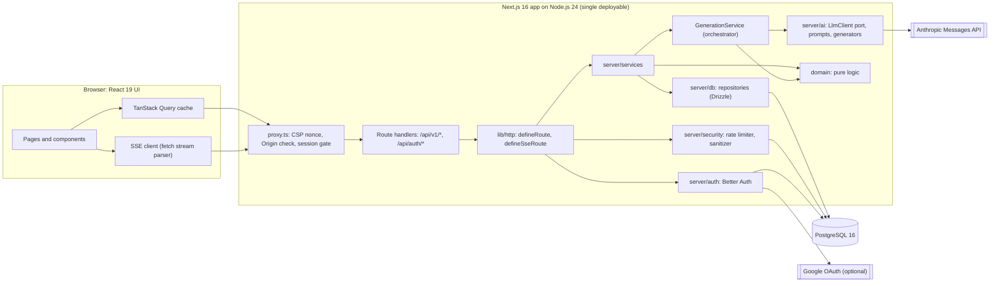

# EventCraft — Architecture Specification

| Field | Value |
|---|---|
| Product | EventCraft, a GenAI-powered planning assistant for weddings, birthdays, and community events |
| Document | `architecture.md` (single source of truth for implementation) |
| Version | 1.0.0 |
| Status | Approved for implementation |
| Last updated | 2026-10-21 |
| Audience | Engineers implementing, reviewing, and operating EventCraft |

**Normative language.** MUST and MUST NOT mark requirements that every implementation satisfies without exception. MAY marks an explicitly optional behavior. Every other sentence is descriptive. Section 14 lists every assumption and open question; nothing is deferred in prose elsewhere.

**Contents**

1. [Project Overview](#1-project-overview)
2. [System Architecture](#2-system-architecture)
3. [Tech Stack](#3-tech-stack)
4. [Directory & File Structure](#4-directory--file-structure)
5. [Core Modules](#5-core-modules)
6. [Data Models](#6-data-models)
7. [API / Interface Contracts](#7-api--interface-contracts)
8. [Implementation Phases](#8-implementation-phases)
9. [Configuration & Environment](#9-configuration--environment)
10. [Error Handling & Edge Cases](#10-error-handling--edge-cases)
11. [Testing Strategy](#11-testing-strategy)
12. [Security Considerations](#12-security-considerations)
13. [Performance & Scalability Notes](#13-performance--scalability-notes)
14. [Open Questions / Assumptions](#14-open-questions--assumptions)

---

## 1. Project Overview

### 1.1 Purpose

EventCraft turns a short description of an event (type, date, guest count, budget, preferences) into a complete, editable plan: a **budget** split across categories, a dated **timeline** of tasks, a **vendor checklist** with questions to ask each vendor, and **personalized ideas**. Users then track the plan (expenses, task progress, vendor status) and ask a grounded assistant for advice. A language model proposes; deterministic code guarantees that money and dates are correct.

### 1.2 Scope

**In scope**

- Three event types: `wedding`, `birthday`, `community`. Each has its own category catalogue and timeline horizon (§5.3).
- Single-owner events with email/password and optional Google sign-in.
- AI generation of four plan sections (`budget`, `timeline`, `vendors`, `ideas`), each independently regenerable.
- Manual create/edit/delete of expenses, tasks, and vendor items; budget category editing with locking.
- Read-only conversational assistant grounded in the event's current plan.
- Export: Markdown plan summary and ICS calendar of the timeline.
- Account deletion that erases all of the user's data.

**Out of scope (MUST NOT be built in this version)**

- Booking, payments, or contracts with vendors; any marketplace or live vendor directory.
- Real vendor names, phone numbers, URLs, or live prices produced by the model (the model produces categories, needs, and questions only).
- Multi-user collaboration, sharing links, or role-based access.
- Guest list, RSVP, seating, or invitation delivery.
- Email/SMS/push notifications and reminders.
- Native mobile apps and UI languages other than English.

### 1.3 Users and primary journeys

| ID | Persona | Journey |
|---|---|---|
| J1 | Couple or family member planning a wedding | Sign up → create event (≤ 8 fields) → watch the plan stream in → lock the venue budget → log deposits → tick tasks. |
| J2 | Parent planning a child's birthday | Create event with dietary and age preferences → review ideas → like/dislike → regenerate ideas → export timeline to a calendar. |
| J3 | Community volunteer chair | Create a community event with a small budget → generate vendor checklist (permits, AV, insurance) → track vendor status from `not_started` to `booked`. |
| J4 | Any user, mid-planning | Ask the assistant "what should I do this week?" → receive an answer grounded in open tasks and budget status. |

### 1.4 Functional requirements

| ID | Requirement | Priority | Acceptance criteria |
|---|---|---|---|
| FR-01 | Create an event with type, title, date, timezone, optional city, guest count, currency, total budget, and preferences. | Must | Valid input returns `201`; invalid input returns `422` with per-field errors; date earlier than today (in the event timezone) is rejected. |
| FR-02 | List, view, update, and delete own events. | Must | Another user's event returns `404` on every endpoint; `PATCH` without `If-Match` returns `428`. |
| FR-03 | Generate the plan (`budget`, `timeline`, `vendors`, `ideas`) in one action with progressive results; regenerate any section independently. | Must | Sections arrive over SSE as each completes; one failed section never discards the others. |
| FR-04 | Allocate the budget across the event type's categories; the sum of allocations equals the total budget at all times. | Must | Property test: for any valid input, `sum(allocatedMinor) === totalBudgetMinor`. |
| FR-05 | Edit a category allocation (locks it); unlocked categories rebalance proportionally. | Must | Editing returns the full category list with the invariant preserved, or `422 BUDGET_BELOW_LOCKED`. |
| FR-06 | Track expenses (`estimated` or `paid`) per category; show allocated, committed, paid, remaining, and a status per category. | Must | Status is `ok`, `near_limit` (committed ≥ 90% of allocation), or `over` (committed > 100%). |
| FR-07 | Generate a dated timeline; tasks that cannot meet their ideal date because of short lead time are compressed into the remaining days and flagged. | Must | No task has a due date before today or after the event date; compressed tasks carry `isCompressed: true`. |
| FR-08 | Add, edit, complete, and delete tasks; filter by status and date range. | Must | Setting `status: "done"` stamps `completedAt`; reopening clears it. |
| FR-09 | Maintain a vendor checklist by category with questions to ask, status pipeline, vendor name, contact, quote, notes, and must-have flag. | Must | Status `quoted` or `booked` requires `vendorName`. |
| FR-10 | Link an expense to a vendor item. | Should | Deleting the vendor item keeps the expense and clears the link. |
| FR-11 | Generate personalized ideas by kind; like, dislike, or save each; regeneration retains saved and rated ideas and avoids repeating disliked ones. | Must | Regeneration never deletes saved, liked, or disliked ideas; disliked titles appear in the exclusion list of the next prompt. |
| FR-12 | Free-text regeneration instructions (≤ 500 characters). | Should | Instructions are fenced as untrusted data in the prompt (§5.9). |
| FR-13 | Assistant chat grounded in the event plan; streams its answer; never modifies data. | Should | The assistant code path has no write access to repositories (§5.9). |
| FR-14 | Export a Markdown plan and an ICS timeline. | Should | ICS imports into Google Calendar and Apple Calendar without error; lines are folded at 75 octets. |
| FR-15 | Sign up, sign in, sign out; Google OAuth is enabled when both Google environment variables are set. | Must | Sessions use `HttpOnly`, `Secure`, `SameSite=Lax` cookies. |
| FR-16 | Delete the account and all owned data. | Must | After `DELETE /api/v1/me`, no row in any table references the user id. |
| FR-17 | Type-specific templates: budget categories, vendor categories, and timeline horizon differ by event type. | Must | Catalogue in §5.3 is the only source of valid category keys. |

### 1.5 Non-functional requirements

| ID | Category | Requirement (measurable) |
|---|---|---|
| NFR-01 | Performance | Server-side p95 ≤ 200 ms for reads and ≤ 300 ms for writes (excluding LLM calls) at 20 concurrent users. |
| NFR-02 | Generation latency | With the provider healthy: first section event ≤ 8 s p95; `run.completed` ≤ 30 s p95. |
| NFR-03 | Availability | Non-AI features: 99.5% monthly. AI failures degrade only the affected section; the rest of the app stays usable. |
| NFR-04 | Security | Meets OWASP ASVS Level 1 for the controls in §12; zero cross-tenant reads or writes in the IDOR suite. |
| NFR-05 | Data integrity | All money is stored as integer minor units; invariants in §6.5 hold after every committed transaction. |
| NFR-06 | Accessibility | WCAG 2.2 AA; axe reports zero `serious` or `critical` violations on every top-level page. |
| NFR-07 | Maintainability | TypeScript `strict`; no `any`; layering enforced by lint (§2.4); files ≤ 300 lines; cyclomatic complexity ≤ 10 per function. |
| NFR-08 | Testability | `domain/` is pure (no I/O). The LLM is replaced by `FakeLlmClient` in every automated test. Coverage thresholds in §11.5. |
| NFR-09 | Observability | One structured JSON log line per request with `requestId`; `/api/health` and `/api/ready` exist. |
| NFR-10 | Privacy | Email, name, and free-text notes are never sent to the LLM; deletion erases all user data (FR-16). |
| NFR-11 | Portability | `docker compose up` starts a working instance given `ANTHROPIC_API_KEY` and `BETTER_AUTH_SECRET`. |
| NFR-12 | Compatibility | Last two versions of evergreen browsers; layout works from 320 px width. |
| NFR-13 | Cost control | One full generation consumes ≤ 8,000 input tokens and ≤ 9,216 output tokens (hard `max_tokens` caps per §5.9); per-user daily quotas in §9. |
| NFR-14 | Resource efficiency | Initial JavaScript ≤ 170 KB gzip on authenticated pages; DB pool ≤ 10 connections per instance; ≤ 512 MB RSS with 20 concurrent SSE streams. |

### 1.6 Success criteria

| ID | Criterion | Verification |
|---|---|---|
| SC-01 | A new user reaches a complete plan (10 budget categories or the type's catalogue size, ≥ 15 tasks, ≥ 6 vendor items, ≥ 8 ideas) within 3 minutes of sign-up. | Playwright E2E with `FakeLlmClient`; timing check on live smoke run. |
| SC-02 | 100% of generated and edited budgets satisfy `sum(allocatedMinor) === totalBudgetMinor`. | Property tests (10,000 cases) plus integration tests. |
| SC-03 | Zero cross-tenant access. | Table-driven IDOR suite covers every endpoint in §7. |
| SC-04 | ≥ 29 of 30 live generations pass schema validation after at most one repair retry. | `pnpm test:live` (manual, pre-release). |
| SC-05 | CI green: lint, typecheck, unit, integration, build, E2E, audit, secret scan. | GitHub Actions. |
| SC-06 | Lighthouse accessibility ≥ 95 and axe zero serious/critical on all top-level pages. | CI E2E job. |
| SC-07 | Every one of the 14 sections of this document maps to a merged artifact (code, config, or test). | Phase exit checklists in §8. |

### 1.7 Evaluation-driven design priorities

Technology and design choices are ranked by the challenge's scoring weights. A choice that raises a high-impact criterion at the cost of a low-impact one is accepted; the reverse is rejected.

| Criterion | Weight | Design response | Evidence |
|---|---|---|---|
| Code Quality | High | Strict TypeScript; pure `domain/` core; layered modules with lint-enforced imports; one Zod schema per contract; ports/adapters around the LLM and database; small files. | NFR-07; ESLint boundaries rule; §4. |
| Problem Statement Alignment | High | Each phrase of the problem statement owns a module: **budgets** → `budget` (§5.4), **timelines** → `timeline` (§5.5), **vendor checklists** → `vendors` (§5.8), **personalized ideas** → `ideas` generator with feedback loop (§5.9); **weddings, birthdays, community events** → template catalogue (§5.3); **GenAI assistant** → generation + chat (§5.9). | FR-01 … FR-17; Traceability table below. |
| Security | Medium | Ownership enforced in the data layer; Better Auth sessions; Origin check + SameSite cookies; Zod at every boundary; CSP with nonce; LLM treated as untrusted (read-only, schema-validated, fenced inputs). | §12; SC-03. |
| Efficiency | Medium | Parallel section generation; SSE instead of polling; capped tokens; Server Components for reads; Postgres-only infrastructure; zero-dependency date/ICS logic. | NFR-02, NFR-13, NFR-14; §13. |
| Testing | Low | Ports make every I/O boundary replaceable; deterministic domain; fake LLM; coverage gates. Effort is bounded: no mutation testing, no contract-testing framework. | §11. |
| Accessibility | Low | Radix primitives and semantic HTML provide most conformance at near-zero cost; `eslint-plugin-jsx-a11y` and axe run in CI. No bespoke widget work beyond that. | NFR-06; §11.4. |

**Traceability: problem statement → design**

| Problem statement phrase | Requirement IDs | Module(s) | API resource |
|---|---|---|---|
| "GenAI-powered planning assistant" | FR-03, FR-12, FR-13 | `server/ai`, `generation.service`, `assistant.service` | `/generation`, `/assistant/messages` |
| "weddings, birthdays, and community events" | FR-01, FR-17 | `domain/templates` | `/events` |
| "budgets" | FR-04, FR-05, FR-06 | `domain/budget`, `budget.service` | `/budget` |
| "timelines" | FR-07, FR-08 | `domain/timeline`, `task.service` | `/tasks` |
| "vendor checklists" | FR-09, FR-10 | `vendor.service` | `/vendors` |
| "personalized ideas" | FR-11, FR-12 | `idea.service`, `ideas.generator` | `/ideas` |

### 1.8 Capacity assumptions (back-of-the-envelope)

These numbers drive the design; they are targets for the first release (assumption A-07).

| Quantity | Estimate | Derivation |
|---|---|---|
| Registered users / DAU | 1,000 / 100 | Target for the first release. |
| Events | 2,000 | 2 per user. |
| API requests | 15,000/day, ~5 req/s at peak | 100 DAU × 150 requests; peak = 10× the mean of 0.17 req/s, rounded up. |
| Generation requests | 200/day | 100 DAU × 2. Each issues 4 LLM calls = 800 calls/day. |
| Assistant messages | 500/day | 100 DAU × 5. |
| Peak LLM concurrency | 5 generation runs (20 calls) | 5× the average hour of the above. |
| Rows per event | ≈ 185 | 10 categories + ≤ 30 tasks + ≤ 12 vendors + ≤ 12 ideas + ≤ 20 expenses + ≤ 100 chat messages. |
| Total storage | ≈ 150 MB | 2,000 events × 185 rows × ≈ 0.4 KB including indexes. One PostgreSQL instance holds this in memory. |
| Read:write ratio | ≈ 10:1 | Planning is review-heavy; writes are edits and generation persists. |

---

## 2. System Architecture

### 2.1 Style and principles

EventCraft is a **modular monolith**: one deployable Next.js application containing the UI, the REST API, and the generation orchestrator, backed by one PostgreSQL database and one external LLM API.

1. **Deterministic where correctness matters, generative where creativity matters.** Money allocation, date arithmetic, and invariants are code. Wording, ideas, and proposed percentages come from the model.
2. **The LLM is an untrusted component.** It receives fenced input, returns schema-constrained JSON, is validated by Zod, has no tools, and cannot write to the database.
3. **Pure core, I/O at the edges.** `domain/` has no imports; every external system sits behind an interface (`LlmClient`, repositories, `Clock`).
4. **Ownership is a data-layer concern.** No repository method accepts an event id without an owner id.
5. **Progressive results.** Sections stream to the client as each completes.
6. **Stateless instances.** All state lives in PostgreSQL; any instance serves any request.

### 2.2 Component diagram



### 2.3 Component responsibilities

| Component | Responsibility | Does NOT do |
|---|---|---|
| `proxy.ts` | Generates a per-request CSP nonce; sets security headers; rejects cross-origin unsafe requests; redirects unauthenticated page requests to `/sign-in`. | Business logic; database access. |
| `lib/http` | Wraps every route: request id, auth, rate limit, size-capped parsing, Zod validation, error-to-problem mapping, logging. | Domain rules. |
| `server/auth` | Better Auth configuration and `requireSession()`. | Authorization of resources (done in repositories). |
| `server/services` | Use cases: orchestrate repositories, domain functions, and generation; enforce business rules and quotas. | SQL; HTTP types. |
| `GenerationService` | Run four section generators in parallel, post-process with domain functions, persist per section in transactions, emit stream events, record `generation_runs`. | Prompt wording; provider specifics. |
| `server/ai` | `LlmClient` port, Anthropic adapter, fake adapter, prompt builders, section generators, input fencing, JSON-schema projection. | Persistence; money or date arithmetic. |
| `domain` | Money, dates, templates, budget allocation, timeline scheduling, summaries. Pure functions only. | I/O; framework imports. |
| `server/db` | Drizzle schema, migrations, repositories scoped by owner. | Business rules beyond integrity constraints. |
| `server/security` | Postgres-backed rate limiter and daily quotas; text sanitizer; client IP resolution. | Authentication. |
| UI | Rendering, form validation (same Zod schemas), optimistic updates, SSE consumption, accessibility. | Trust decisions; direct database access. |

### 2.4 Layering rules (enforced by ESLint `boundaries` and `import/no-restricted-paths`)

| Layer | MAY import | MUST NOT import |
|---|---|---|
| `domain` | TypeScript standard library only | everything else |
| `schemas` | `domain`, `zod` | `server`, `components`, `app` |
| `server/db` | `domain`, `schemas`, `drizzle-orm`, `pg` | `server/services`, `server/ai`, `app` |
| `server/ai` | `domain`, `schemas`, `@anthropic-ai/sdk` | `server/db`, `app` |
| `server/security` | `domain`, `server/db` | `server/services`, `app` |
| `server/services` | `domain`, `schemas`, `server/db`, `server/ai`, `server/security` | `app`, `components`, `next/*` |
| `lib/http` | `schemas`, `server/auth`, `server/security`, `lib/*` | `server/services` internals (receives handlers by injection) |
| `app/api/**` | `lib/http`, `server/container`, `schemas` | `server/db`, `server/ai` directly |
| `app/**` pages (Server Components) | `components`, `server/container` (read use cases only), `schemas` | `server/db`, `server/ai` |
| `components/**` (Client Components) | `components`, `lib/client`, `schemas` (types and validators) | any `server/*` module |

Every file under `src/server/` begins with `import "server-only";` so that a client import fails at build time.

### 2.5 Generation data flow

```mermaid
sequenceDiagram
  autonumber
  participant B as Browser
  participant R as Route handler
  participant G as GenerationService
  participant D as PostgreSQL
  participant L as LlmClient (Anthropic)

  B->>R: POST /api/v1/events/:eventId/generation (Accept: text/event-stream)
  R->>R: Origin check, session, rate limit, quota, Zod validation
  R->>G: run(ctx, eventId, input, signal)
  G->>D: load owned event, feedback; insert generation_runs (status running)
  G-->>B: event run.started
  par budget
    G->>L: generateObject(budget schema, primary model)
    L-->>G: allocations (bps)
    G->>G: normalizeAllocations (domain)
    G->>D: transaction: replace unlocked categories
    G-->>B: event section.completed (budget)
  and timeline
    G->>L: generateObject(timeline schema, primary model)
    L-->>G: task drafts (offsets)
    G->>G: scheduleTasks (domain)
    G->>D: transaction: replace unmodified AI tasks
    G-->>B: event section.completed (timeline)
  and vendors
    G->>L: generateObject(vendors schema, fast model)
    G->>D: transaction: replace unmodified AI vendor items
    G-->>B: event section.completed (vendors)
  and ideas
    G->>L: generateObject(ideas schema, primary model)
    G->>D: transaction: replace unrated AI ideas
    G-->>B: event section.completed (ideas)
  end
  G->>D: finalize generation_runs rows (succeeded or failed)
  G-->>B: event run.completed
```

Rules of the flow:

- Sections run concurrently with `Promise.allSettled`; a failed section emits `section.failed` and does not cancel siblings.
- Each section persists in its own transaction immediately on completion, so a client disconnect never loses finished sections.
- The request's `AbortSignal` is passed to every LLM call. On disconnect, in-flight calls abort (cost control) and their `generation_runs` rows are finalized as `failed` with `error_code = 'CLIENT_ABORTED'`.
- A partial unique index on `generation_runs (event_id, section) WHERE status = 'running'` rejects concurrent runs of the same section with `409 GENERATION_IN_PROGRESS`.

### 2.6 Non-AI request lifecycle

1. `proxy.ts` sets CSP nonce and headers; for `POST/PUT/PATCH/DELETE` to `/api/*`, compares the `Origin` header to `APP_URL` and returns `403` on mismatch.
2. `defineRoute` assigns `requestId` (UUID v4), starts a timer, and resolves the session.
3. Rate limiter consumes one unit for the route's bucket; exceeding it returns `429` with `Retry-After`.
4. Body is read with a 64 KB cap, parsed as JSON, and validated with the route's Zod schemas.
5. The service executes; repositories scope every query by `ownerId`.
6. Errors are mapped to RFC 9457 `application/problem+json`; the response carries `X-Request-Id`; one log line is written.

### 2.7 Key decisions and trade-offs

| # | Decision | Solves | Worsens | Revisit when |
|---|---|---|---|---|
| D1 | Modular monolith | One deploy, in-process calls, simple tests and CI | Cannot scale modules independently | Generation load starves API latency (p95 reads > 400 ms) or a second team owns a module |
| D2 | SSE streaming of section results | Progressive UX without queue infrastructure | Long-lived connections; platform request-duration caps | p95 full generation > 60 s or the host caps requests below 60 s → move to a Postgres-backed job queue (`pg-boss`) with polling |
| D3 | Four parallel section generators instead of one large prompt | Lower wall-clock latency; isolated failures; small schemas that validate reliably | Cross-section consistency is not guaranteed by the model | Measured inconsistency > 5% (e.g., a task referencing a category with no vendor item). Mitigation today: shared template catalogue keys. |
| D4 | Deterministic money and date logic | Exact totals; reproducible results; unit-testable | Rigid catalogue per event type | A fourth event type is added (add a template entry; no code change elsewhere) |
| D5 | PostgreSQL-backed rate limiter and quotas | No additional infrastructure; shared across instances | Extra writes; fixed-window burst at boundaries | Sustained > 50 req/s → move counters to Redis behind the same `RateLimiter` interface |
| D6 | Read-only assistant | Prompt injection cannot change data | User applies suggestions manually | A confirm-before-apply flow is specified; then add tool calls that return proposals, never writes |
| D7 | REST + Zod instead of tRPC or GraphQL | Explicit, curl-able contracts; SSE fits naturally; one validation source | Client types come from shared schemas rather than inferred RPC types | A non-web client needs generated SDKs → emit OpenAPI from the Zod schemas |
| D8 | Structured outputs + Zod validation + one repair retry | Near-zero malformed output; defense in depth | Extra schema-projection code | Provider drops structured outputs on a chosen model → switch the adapter to forced tool use (same port) |
| D9 | `LlmClient` port with adapters | Provider swap in one file; fake client for tests | One extra abstraction | Never; the abstraction is the testing seam |
| D10 | Integer minor units for money | No floating-point error | Conversion at UI boundary | Never |
